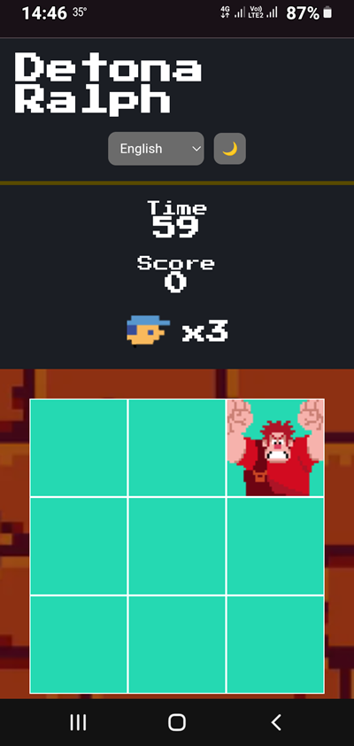

# Creating a Wreck-It Ralph Game with JavaScript

Project developed during the Potência Tech iFood Game Development Bootcamp, under the guidance of expert [Felipe Aguiar](https://github.com/felipeAguiarCode "Felipe Aguiar").

In this project challenge, we will use HTML5, CSS3, and JavaScript to create a game based on the movie *Wreck-It Ralph*, where the goal is to hit Ralph whenever he appears in a window. Throughout the project, we will explore JavaScript events and learn how to manipulate audio within the browser.

## Features

- Responsive layout
- Desktop, tablet and mobile support
- Dark mode (default)
- Light mode
- Language switcher:
  - English (default)
  - Portuguese (Brazil)
  - Spanish
- Accessible HTML structure
- Score system
- Countdown timer
- Ralph random movement
- Sound support ready for expansion

## Technologies

- **HTML5** and **CSS3** for the game's structure and appearance.
- **JavaScript** for programming logic and interactivity.
- Custom sprites and images to create the unique aesthetic of the Wreck-It Ralph universe.

## Amazing Features

- **Scoring System**: Track your score as you progress through the game and challenge your friends to beat it; click on the square where Ralph is located.

## How to Play

1. Clone this repository to your local machine.
2. Open the `index.html` file in your web browser.
3. Use the arrow keys to move the character and the spacebar to interact.
4. Have fun exploring and collecting coins, but watch out for enemies!

## Accessibility

This project includes:

- Semantic HTML
- ARIA labels
- Responsive design
- Keyboard-friendly controls
- High-contrast interface

## Author

Project created for study purposes and JavaScript practice during the Digital Innovation One challenge.

See [repository original](https://github.com/digitalinnovationone/jsgame-detona-ralph).

[LICENSE](/LICENSE)
